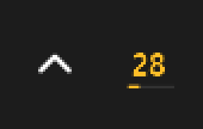

# Fox Battery Taskbar

A tiny Windows tray app that shows your **Fox ESS** home battery's state of charge in the taskbar.



- The icon shows the battery percentage, coloured **green** (≥ 50%), **amber** (≥ 20%) or **red**, with a fill bar along the bottom.
- A green corner marker means the battery is **charging**. `!` means something went wrong; hover for details. A **grey** number means the reading is old (for example, just after waking from sleep).
- Colours adapt to a light or dark taskbar.
- The tooltip shows charge/discharge power, solar, house load and grid import/export.
- It polls Fox Cloud every 5 minutes by default. Double-click the icon to refresh now.

> Not affiliated with or endorsed by Fox ESS. It uses the public [Fox ESS Cloud Open API](https://www.foxesscloud.com/public/i18n/en/OpenApiDocument.html).

## Install

1. Download `FoxBatteryTaskbar.exe` (or `FoxBatteryTaskbar-arm64.exe` for Windows on ARM) from the [latest release](../../releases/latest). It's a single self-contained file, so you don't need to install .NET. Put it somewhere permanent, e.g. `%LOCALAPPDATA%\Programs\FoxBatteryTaskbar\`.
2. Run it. On first run it asks for your **Fox Cloud API key**.
3. Optional: right-click the icon and tick **Start with Windows**.

Windows 11 hides new tray icons. To keep it visible, drag it from the `^` overflow onto the taskbar. Or go to **Settings → Personalization → Taskbar → Other system tray icons** and switch **Fox Battery Taskbar** on.

### Updating

Right-click the icon ? **About / check for updates**, download the new exe, choose **Exit**, then replace the old file. Your settings and key are kept. See [CHANGELOG.md](CHANGELOG.md) for what changed.

### Uninstalling

1. Right-click the icon and untick **Start with Windows**, then choose **Exit**.
2. Delete the exe.
3. Delete `%APPDATA%\FoxBatteryTaskbar` (settings and encrypted key).
4. Optional: revoke the API key in Fox Cloud (User Profile ? API Management).

### Getting an API key

1. Sign in at [foxesscloud.com](https://www.foxesscloud.com/login).
2. Open your profile (top right) → **User Profile** → **API Management**.
3. Click **Generate API key** and paste it into the app.

## Configuration

Settings live in `%APPDATA%\FoxBatteryTaskbar\`. Use **Open settings folder** in the tray menu to get there.

| File | Purpose |
|---|---|
| `apikey.bin` | Your API key, encrypted with Windows DPAPI so only your Windows account can read it. |
| `settings.json` | Optional settings (below). Created automatically after the first successful read. |

```json
{
  "BaseUrl": "https://www.foxesscloud.com",
  "DeviceSerial": null,
  "PollMinutes": 5
}
```

- **BaseUrl**: `https://www.foxesscloud.com` (Europe/default) or `https://portal.foxesscloud.us` (US). For safety, any other value is ignored and the default is used. See [SECURITY.md](SECURITY.md).
- **DeviceSerial**: your inverter serial number. If it's empty, the app uses the first device on your account.
- **PollMinutes**: how often to refresh. Values are clamped to 2–1440, because Fox Cloud data only updates every few minutes and the API has a daily call limit.

You can also supply the key with the `FOXESS_API_KEY` environment variable. It takes priority over the stored key, and the app warns you if you enter a key in the dialog while it's set.

If something goes wrong (network down, Fox Cloud error, unexpected response), the icon shows a red `!` with the reason in its tooltip, and the app retries on the next poll.

## Build from source

You need the [.NET 10 SDK](https://dotnet.microsoft.com/download).

```bash
dotnet build
```

Run the unit tests. They use canned responses in `tests/.../Samples`, so they need no API key or network:

```bash
dotnet test
```

Run a one-off check against your real battery, which prints a reading to the terminal:

```bash
dotnet run --project src/FoxBatteryTaskbar -- --test
```

Produce a single self-contained exe in `publish/`:

```bash
dotnet publish src/FoxBatteryTaskbar -c Release -r win-x64 --self-contained -p:PublishSingleFile=true -p:IncludeNativeLibrariesForSelfExtract=true -p:EnableCompressionInSingleFile=true -o publish
```

Use `-r win-arm64` for an ARM64 build.

### Releasing

1. Bump `<Version>` in [`Directory.Build.props`](Directory.Build.props) and add a section to [CHANGELOG.md](CHANGELOG.md).
2. Commit, then tag and push, e.g. `git tag -a v0.1.1 -m v0.1.1 && git push origin v0.1.1`.
3. CI builds and tests both architectures, then publishes a GitHub release with the exes, `SHA256SUMS.txt` and a build provenance attestation (see [`.github/workflows/build.yml`](.github/workflows/build.yml)).

The app icon is generated by [`tools/make-icon.ps1`](tools/make-icon.ps1).

## How it works

- [`FoxCloudClient.cs`](src/FoxBatteryTaskbar/FoxCloudClient.cs) calls `POST /op/v0/device/real/query`. Each request is signed with `md5(path + "\r\n" + apiKey + "\r\n" + timestampMs)`, where `\r\n` is the literal four characters, as Fox's docs specify.
- [`BatteryReader.cs`](src/FoxBatteryTaskbar/BatteryReader.cs) is the single path from settings + key to a reading, shared by the tray and `--test`.
- [`TrayText.cs`](src/FoxBatteryTaskbar/TrayText.cs) builds the tooltip and keeps it inside Windows' length limit.
- [`TrayIconRenderer.cs`](src/FoxBatteryTaskbar/TrayIconRenderer.cs) draws the icon at the taskbar monitor's DPI, so it stays sharp on high-DPI screens, using colours from [`TrayPalette.cs`](src/FoxBatteryTaskbar/TrayPalette.cs).
- [`TrayApplicationContext.cs`](src/FoxBatteryTaskbar/TrayApplicationContext.cs) wires it together: tray icon, menu, polling, sleep/resume, theme changes and the "Start with Windows" `HKCU\...\Run` entry.

## Contributing

Issues and pull requests are welcome. `main` is protected: changes go through a pull request, and the `build` check (build + tests) must pass. Please run `dotnet test` before opening a PR.

## Security

See [SECURITY.md](SECURITY.md) for how the API key is stored and sent, how to verify a download, and how to report a vulnerability.

## Licence

[MIT](LICENSE)
